<div align="center">

# Amethyst Suites & Dining

### A full‑stack hotel, restaurant and events platform with room booking, table reservations, ticketing and Paystack payments.

Guests can browse rooms, reserve a table, buy event tickets and look up their bookings without creating an account. Staff run bookings and events from an admin area protected by a passcode.

**Live site: [amethyst-sd.vercel.app](https://amethyst-sd.vercel.app)**


-0ba4db.svg)


</div>

---

## Table of contents

- [What is Amethyst?](#what-is-amethyst)
- [Screenshots](#screenshots)
- [Features](#features)
- [Tech stack](#tech-stack)
- [System architecture](#system-architecture)
- [Booking & payment lifecycle](#booking--payment-lifecycle)
- [Event ticketing flow](#event-ticketing-flow)
- [Repository layout](#repository-layout)
- [Getting started](#getting-started)
- [Environment configuration](#environment-configuration)
- [API reference](#api-reference)
- [Deployment](#deployment)
- [Project status & roadmap](#project-status--roadmap)
- [Author](#author)
- [License](#license)

---

## What is Amethyst?

**Amethyst Suites & Dining** is a fictional luxury hotel in East Legon, Accra. This project is its website and booking backend. Guests can do four things without signing up:

1. **Book a room.** Pick a room type and dates, see which nights are already taken, and pay through Paystack in Ghana cedis (GH₵).
2. **Reserve a table.** Choose a dining area, table, date and time slot. Dining reservations are free and confirmed straight away.
3. **Buy event tickets.** Browse events such as jazz nights, cooking classes and wine tastings, pick a ticket tier and pay. Each ticket gets its own code that can be checked later.
4. **Manage a booking.** Look up a booking with its reference and email address, view the details, pay an unpaid balance or download a PDF invoice.

Staff log in to an **admin area** with a shared passcode. From there they can see every booking, mark bookings completed or cancelled, and create, edit or delete events.

The project is two repositories that work together:

| Repo | What it is |
| --- | --- |
| [`amethyst-frontend`](https://github.com/FosterSOAsare/amethyst-frontend) (this repo) | React 19 + Vite web client, deployed on Vercel |
| [`amethyst-backend`](https://github.com/FosterSOAsare/amethyst-backend) | Express 5 + MongoDB REST API that handles bookings, events, tickets, payments and email |

---

## Screenshots

> Captured from the live site at [amethyst-sd.vercel.app](https://amethyst-sd.vercel.app). Prices are in Ghana cedis (GH₵).

<table>
  <tr>
    <td colspan="2">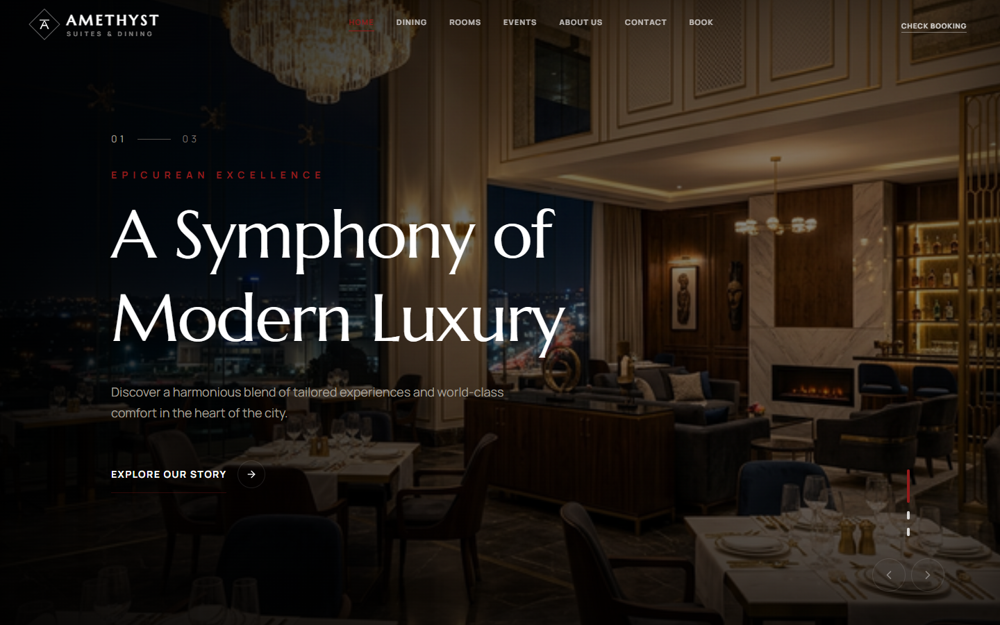</td>
  </tr>
  <tr>
    <td width="50%">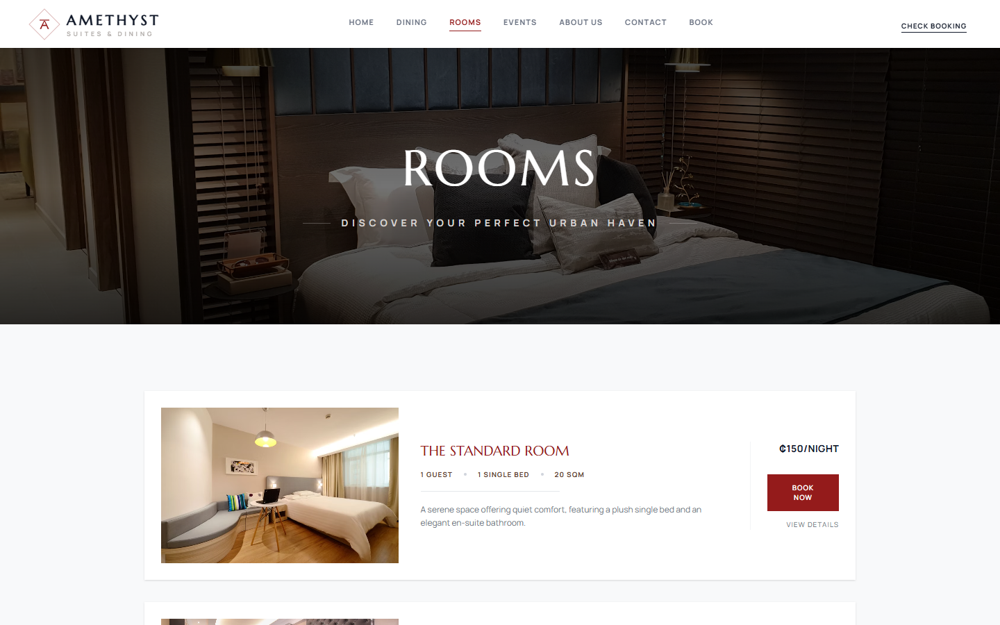<br/><sub><b>Rooms</b>: six room types with nightly rates</sub></td>
    <td width="50%">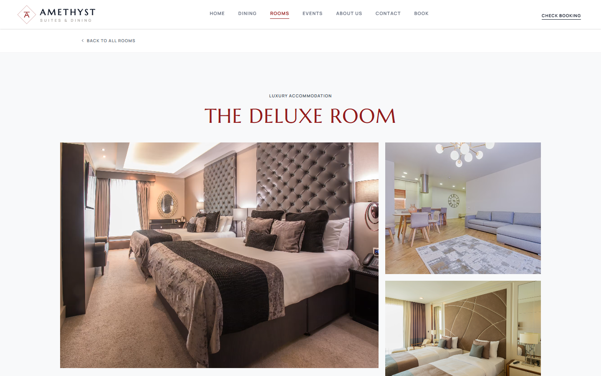<br/><sub><b>Room detail</b>: gallery, amenities and booking</sub></td>
  </tr>
  <tr>
    <td width="50%">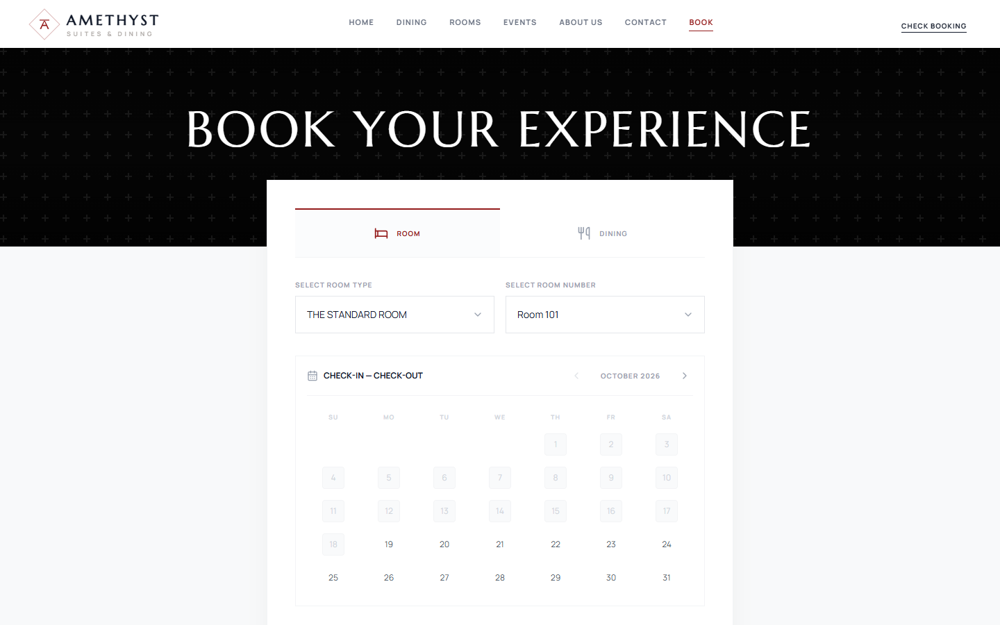<br/><sub><b>Booking</b>: pick a room or table, with past and booked dates blocked</sub></td>
    <td width="50%">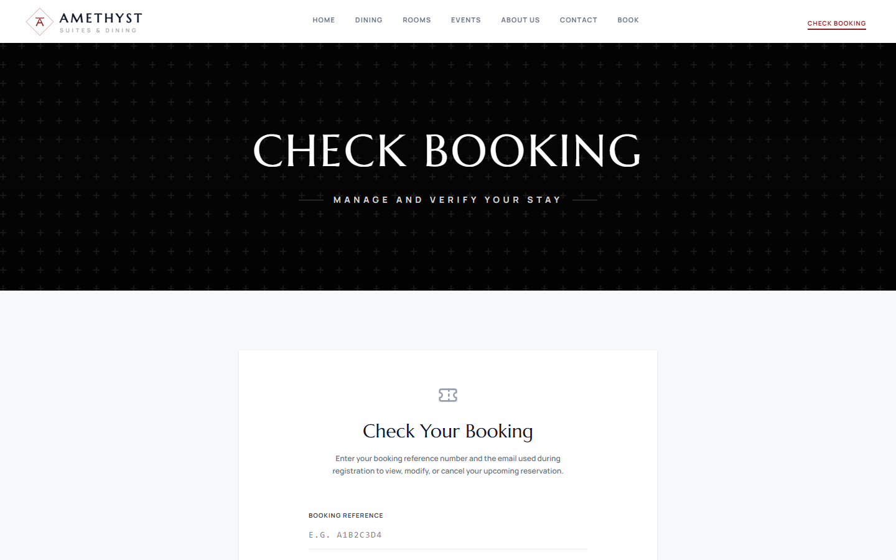<br/><sub><b>Check booking</b>: look up a booking with its reference and email</sub></td>
  </tr>
  <tr>
    <td width="50%">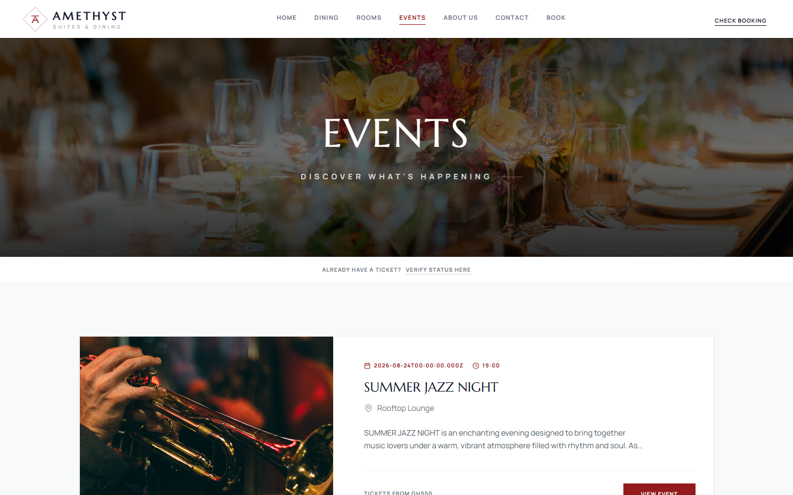<br/><sub><b>Events</b>: upcoming events and ticket prices</sub></td>
    <td width="50%">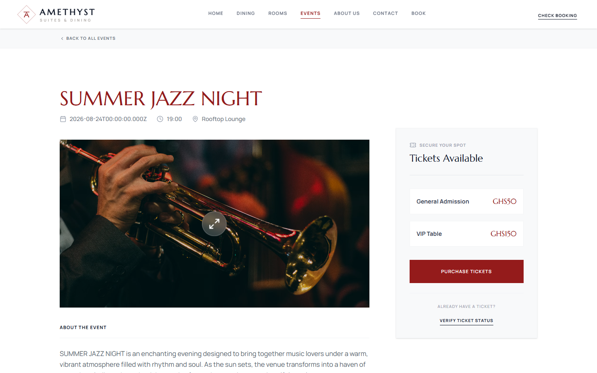<br/><sub><b>Event detail</b>: ticket tiers and purchase</sub></td>
  </tr>
  <tr>
    <td width="50%">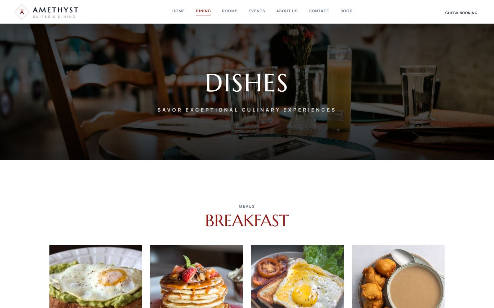<br/><sub><b>Dining</b>: the menu, grouped by meal</sub></td>
    <td width="50%" align="center">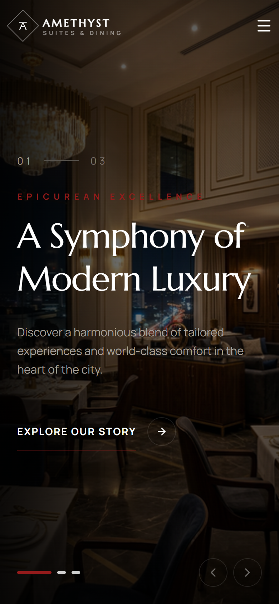<br/><sub><b>Responsive</b>: the site at phone width</sub></td>
  </tr>
</table>

---

## Features

<table>
<tr><td width="50%" valign="top">

**Rooms**
- Six room types, from the Standard Room (GH₵150/night) to the Presidential Suite (GH₵1,200/night)
- Room detail pages with a gallery, amenities and policies
- A date picker that knows availability and blocks nights that are already booked
- The server works out the price from nightly rate × nights

**Dining**
- Dining areas (Main Dining Room, Outdoor Patio, …) and tables with set capacities
- A time‑slot picker that hides slots that are already taken
- Free reservations, confirmed straight away with an email
- Menu and dishes pages with category filters and an FAQ

**Events & ticketing**
- Event listing and detail pages with several ticket tiers (Regular, VIP, …)
- Optional stock limits for each tier; unlimited when left unset
- Paystack checkout, then one unique `TC‑XXXXXX` code per ticket
- A ticket verification page that confirms a code is valid

</td><td width="50%" valign="top">

**Guest self‑service**
- Booking lookup with a reference and email address, so no account is needed
- Booking detail cards for the stay or reservation, payment summary, policies and contact details
- A "Pay now" link if a room booking is still unpaid
- A **downloadable PDF invoice** generated in the browser

**Payments**
- Paystack hosted checkout in **GHS**
- The server checks every payment with Paystack before changing a booking or ticket status
- Retrying a payment creates a fresh transaction reference each time (`REF‑timestamp`)

**Transactional email**
- HTML templates for booking confirmations, ticket purchases and contact form messages
- Sent over SMTP with Nodemailer. If no credentials are set, the email is logged to the console instead

**Admin area**
- Passcode login that returns a 30‑day JWT
- A bookings dashboard filtered by type and status, with complete and cancel actions
- Create, edit and delete events, including their ticket tiers

**Design**
- Framer Motion animations, an animated hero slider, a custom cursor and image lightboxes
- Responsive down to phone width, with SEO meta tags and an Open Graph card

</td></tr>
</table>

---

## Tech stack

| Tier | Technology | Notes |
| --- | --- | --- |
| **Web** | React 19 · Vite 7 · TypeScript | Pages and feature folders, deployed on Vercel |
| **Routing** | React Router 7 | Admin routes wrapped in a `ProtectedRoute` |
| **Data fetching** | TanStack Query 5 | One shared `api()` helper adds the admin bearer token |
| **Forms & validation** | React Hook Form · Zod 4 | A schema for each feature (booking, contact, event, check‑booking) |
| **Styling & motion** | Tailwind CSS 4 · Framer Motion · Lucide / React Icons | |
| **PDF** | `@react-pdf/renderer` | Builds booking invoices in the browser |
| **API** | Node.js · Express 5 · TypeScript | Each feature has its own router, controller and service |
| **Database** | MongoDB · Mongoose 8 | `Booking`, `Event`, `Ticket` and `TicketPurchase` models |
| **Auth** | JWT (`jsonwebtoken`) | One shared admin passcode; guests don't need accounts |
| **Payments** | Paystack | Initialize and verify a transaction, in GHS |
| **Email** | Nodemailer (SMTP) | HTML templates in `templates/` |

---

## System architecture

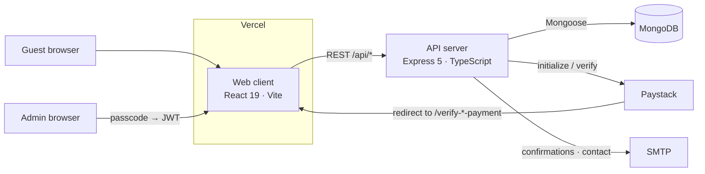

The room catalogue, dining areas, dishes, testimonials and other marketing content are **static data in the web client** (`src/features/*/data`). Only bookings, events, ticket tiers and ticket purchases are stored in MongoDB.

---

## Booking & payment lifecycle

Rooms and dining tables use the same `Booking` model. Before a booking is created, the server rejects it if an existing booking for the same room or table, that isn't cancelled, overlaps the requested dates (`checkIn < other.checkOut && checkOut > other.checkIn`).

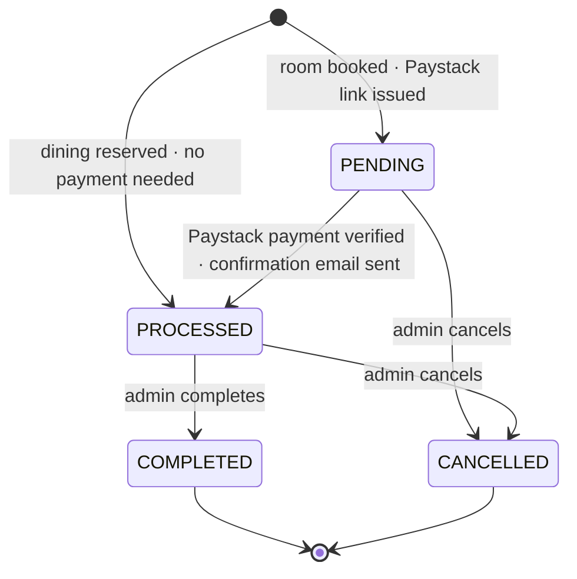

**Room booking:**

1. The guest submits the booking form. The API checks the dates and conflicts, works out `rate × nights` and saves a `PENDING` booking with an 8‑character reference.
2. The API creates a Paystack checkout link, and the guest is redirected to pay.
3. Paystack sends the guest back to `/verify-booking-payment?reference=…`. The client asks the API to verify the payment.
4. If the payment succeeded, the booking moves to `PROCESSED` and the guest gets a confirmation email with a link to their booking.

**Worked example:** a Deluxe Room (GH₵220/night) booked from 12 to 15 March is 3 nights, so the guest is charged **GH₵660**.

---

## Event ticketing flow

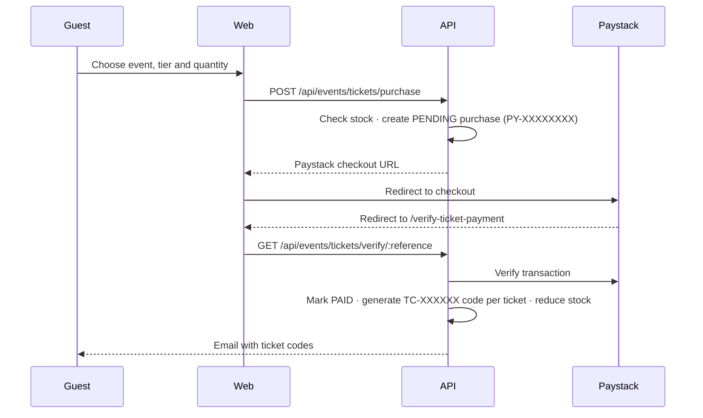

At the door, staff can look up any single `TC‑` code on `/verify-ticket`. The page shows only that ticket. It doesn't reveal the payment reference or the other tickets from the same purchase.

---

## Repository layout

```
amethyst/
├── client/                    # this repo: amethyst-frontend
│   ├── public/assets/         # favicon, OG card, static images
│   ├── src/
│   │   ├── pages/             # one component per route
│   │   └── features/          # feature folders: actions/ · data/ · schema/ · ui/ · utils/
│   │       ├── homepage/      #   hero, intro, rooms, menu, amenities, testimonials
│   │       ├── rooms/         #   room catalogue, room instances, policies
│   │       ├── book/          #   booking form, calendar, time picker, availability
│   │       ├── check-booking/ #   booking lookup, admin bookings list, payments
│   │       ├── view-booking/  #   booking detail cards + PDF invoice
│   │       ├── events/        #   listing, ticket purchase, admin event form
│   │       ├── dishes/ · about/ · contact/ · faq/
│   │       ├── auth/          #   admin passcode login
│   │       └── shared/        #   api client, header/footer, UI primitives, ProtectedRoute
│   └── vercel.json            # SPA rewrite so client‑side routes resolve
│
└── server/                    # amethyst-backend
    ├── src/
    │   ├── index.ts           # Express app, route mounting, /health
    │   └── features/
    │       ├── auth/          # passcode → JWT, requireAdmin middleware
    │       ├── booking/       # rooms + dining bookings, availability, payment verify
    │       ├── events/        # events CRUD, ticket purchase + verification
    │       ├── tickets/       # Ticket (tier) and TicketPurchase models
    │       ├── payment/       # Paystack service
    │       ├── contact/       # contact form → admin email
    │       └── shared/        # db config, email service, helpers
    ├── templates/             # HTML email templates
    └── .env.example
```

---

## Getting started

### Prerequisites

- **Node.js 20 or newer** and npm
- A **MongoDB** database, either local or a free [MongoDB Atlas](https://www.mongodb.com/atlas) cluster
- A **Paystack** account; [test keys](https://dashboard.paystack.com/#/settings/developers) work fine
- (Optional) **SMTP** credentials if you want real emails to be sent

### 1. Clone both repos

```bash
mkdir amethyst && cd amethyst
git clone https://github.com/FosterSOAsare/amethyst-frontend.git client
git clone https://github.com/FosterSOAsare/amethyst-backend.git server
```

### 2. API server

```bash
cd server
npm install
cp .env.example .env          # fill in MONGODB_URI, JWT_SECRET, ADMIN_PASSCODE, PAYSTACK_SECRET_KEY
npm run dev                   # http://localhost:8000  (health check: /health)
```

### 3. Web client

```bash
cd client
npm install
echo "VITE_API_URL=http://localhost:8000/api" > .env
npm run dev                   # http://localhost:5173
```

> **Note:** `VITE_API_URL` must end in `/api`, because the server mounts every route under `/api`. If it isn't set, the client falls back to `http://localhost:4000`, which is not the server's default port.

To use the admin area, go to `/admin/login` and enter the `ADMIN_PASSCODE` from the server's `.env`.

### Scripts

| Where | Script | What it does |
| --- | --- | --- |
| client | `npm run dev` | Vite dev server, also reachable over your local network (`--host`) |
| client | `npm run build` | Type‑check, then build into `dist/` |
| client | `npm run preview` | Serve the production build locally |
| client | `npm run lint` | ESLint |
| server | `npm run dev` | `tsx watch`, which restarts on changes |
| server | `npm run build` / `npm start` | Compile to `dist/` and run it |
| server | `npm run prod` | Build, then start |

---

## Environment configuration

### Server (`server/.env`)

| Variable | Required | Purpose |
| --- | --- | --- |
| `PORT` | No | Port the API listens on (default `8000`) |
| `MONGODB_URI` | Yes | MongoDB connection string |
| `JWT_SECRET` | Yes | Secret used to sign admin tokens |
| `ADMIN_PASSCODE` | Yes | The shared passcode for the admin area |
| `PAYSTACK_SECRET_KEY` | Yes, for payments | Paystack secret key (`sk_test_…` or `sk_live_…`) |
| `FRONTEND_URL` | Yes | Base URL for Paystack callbacks and email links, e.g. `https://amethyst-sd.vercel.app` |
| `SMTP_HOST` / `SMTP_PORT` / `SMTP_SECURE` | No | SMTP server (port defaults to `587`; secure on `465`) |
| `SMTP_USER` / `SMTP_PASS` | No | SMTP login. If left blank, emails are logged to the console |
| `ADMIN_EMAIL` | No | Inbox that receives contact form messages |

### Client (`client/.env`)

| Variable | Required | Purpose |
| --- | --- | --- |
| `VITE_API_URL` | Yes | API base URL **including `/api`**, e.g. `http://localhost:8000/api` |

> **Secrets never go in the repo.** `.env` files are gitignored and only `.env.example` is committed.

---

## API reference

All routes are under `/api`. Admin routes need an `Authorization: Bearer <admin JWT>` header.

| Method | Route | Access | Description |
| --- | --- | --- | --- |
| `POST` | `/auth/login` | Public | Swap the admin passcode for a JWT |
| `GET` | `/auth/me` | Admin | Get the current admin |
| `POST` | `/bookings` | Public | Create a room or dining booking (returns a Paystack link for rooms) |
| `GET` | `/bookings/check-availability` | Public | Get booked periods for a room or table |
| `GET` | `/bookings/verify?reference=&email=` | Public | Look up a booking for a guest |
| `GET` | `/bookings/verify-payment/:reference` | Public | Verify a Paystack payment and confirm the booking |
| `POST` | `/bookings/:reference/payment` | Public | Get a new payment link for a `PENDING` booking |
| `GET` | `/bookings/:id` | Public | Get one booking by reference |
| `GET` | `/bookings` | Admin | List all bookings (`?type=` and `?status=` filters) |
| `POST` | `/bookings/:id/complete` | Admin | Mark a booking completed |
| `POST` | `/bookings/:id/cancel` | Admin | Cancel a booking |
| `GET` | `/events` | Public | List events with their ticket tiers |
| `GET` | `/events/:id` | Public | Get one event |
| `POST` / `PUT` / `DELETE` | `/events` · `/events/:id` | Admin | Create, update or delete an event |
| `POST` | `/events/tickets/purchase` | Public | Start a ticket purchase (returns a Paystack link) |
| `GET` | `/events/tickets/verify/:reference` | Public | Verify a payment, or check a single `TC‑` ticket code |
| `GET` | `/events/tickets/ref/:reference` | Public | Get a purchase by its payment reference |
| `GET` | `/events/tickets/email/:email` | Public | List purchases for an email address |
| `POST` | `/contact` | Public | Send a contact form message to the admin inbox |
| `GET` | `/health` | Public | Health check (not under `/api`) |

---

## Deployment

| Piece | Host | Notes |
| --- | --- | --- |
| Web | **Vercel**: [amethyst-sd.vercel.app](https://amethyst-sd.vercel.app) | `vercel.json` rewrites every path to `index.html` so routes like `/bookings/:id` work. Set `VITE_API_URL` in the project's environment variables |
| API | Any Node host | Build with `npm run build` and start with `npm start`. Set `FRONTEND_URL` to the live site so Paystack redirects and email links point to the right place |
| Database | MongoDB Atlas | Add the API host's IP to the cluster's allowlist |

Before going live, switch Paystack to live keys and point `FRONTEND_URL` at the production domain.

---

## Project status & roadmap

**Working from start to finish:** room booking with availability checks and Paystack payment · dining reservations · event ticket purchases and per‑ticket codes · guest booking lookup and PDF invoices · admin login, bookings dashboard and event management · confirmation and contact emails.

**Static content:** the rooms, dining areas, dishes, testimonials and team are stored as data in the client, not managed through the API. Nightly room rates are also hard‑coded on the server, so they have to be kept in sync with the client's room data.

**Ideas for later:**
- Move rooms, dishes and dining areas into the database, with admin screens to edit them
- A Paystack webhook so payments are confirmed even if the guest closes the tab before being redirected
- Hold ticket stock while a purchase is `PENDING`, so popular tiers can't be oversold
- Let guests cancel their own bookings, with a refund policy
- Admin accounts with roles, instead of one shared passcode

---

## Author

Built by **Foster Solomon Owusu Asare** ([@FosterSOAsare](https://github.com/FosterSOAsare)).

---

## License

Released under the **MIT License**. Third‑party dependencies keep their own licenses. Room, dish and event images are linked from Unsplash, Pexels and other sources and belong to their owners.
